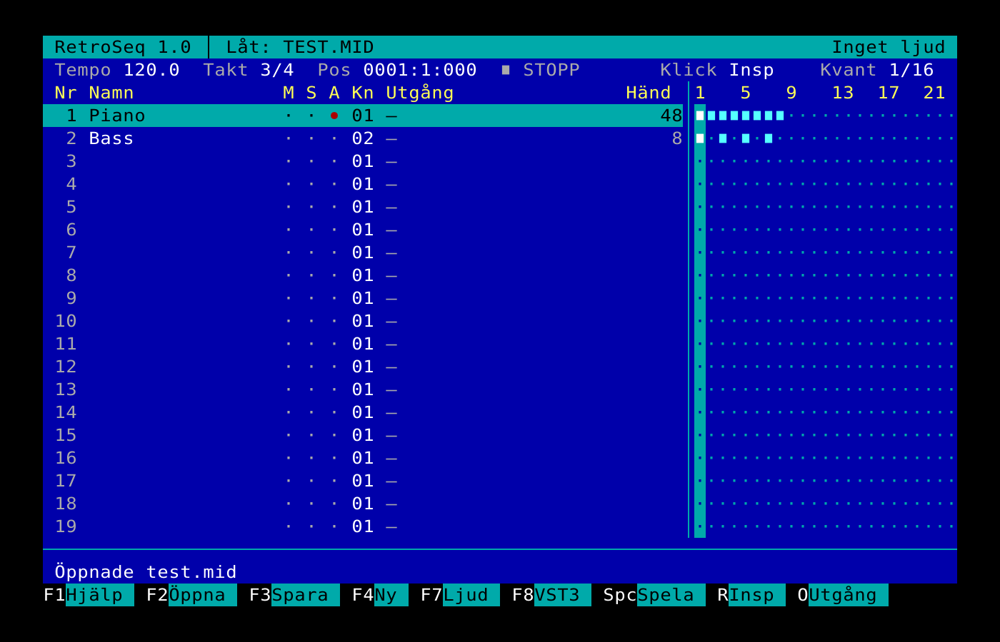
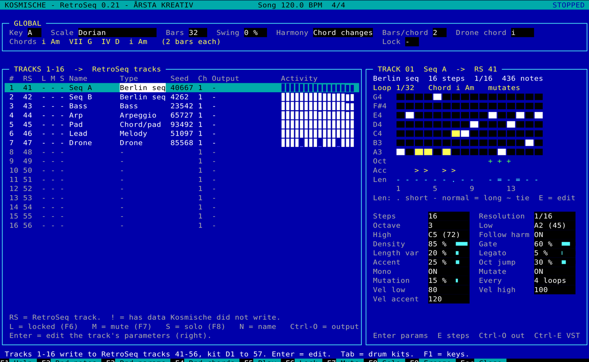

# RetroSeq

A keyboard-driven MIDI sequencer for Windows modelled on Voyetra Sequencer Plus Gold 4: blue 80×25 text screen, Main and View screens, menu commands run by their first letter, and the same function and Ctrl keys. Instead of an MPU-401 it uses Windows MIDI in/out, and any track can play a VST3 instrument. ASIO is supported.

RetroSeq includes **Kosmische**, a Berlin School sequence generator (press **K**): step sequences, bass lines, melodies, arpeggios, pads, drones and Euclidean drum kits in the style of Tangerine Dream and Klaus Schulze, written straight to RetroSeq tracks.



**Download:** the Windows installer is under [Releases](../../releases). It includes the *RetroSeq Reference Manual* and the *Kosmische Manual* (also in `Installer/Manual`).

RetroSeq is free.

## Kosmische (K)



**K** on the Main or View screen opens Kosmische in its own window. It generates up to 16 tracks and 4 drum kits in a chosen key and scale and writes each to a RetroSeq track (by default tracks 41–56 and 57–60), where you listen through your own VST3 instruments or MIDI synths.

- Track types: Berlin seq, Bass, Melody, Arpeggio, Chord/pad, Drone. Chord changes within the scale or a drone chord; patterns follow the chords and mutate slowly.
- Every track has a seed: the same settings and seed always give the same notes. F2 new notes, F3 new parameters, F4 new chords, F6 lock.
- Note length per step (short, normal, long, tie) and a Mono mode for monophonic synths.
- Drum kits (Tab): eight lanes per kit, each a Euclidean pattern (hits over a length, rotated) with probability, accents and ghost notes. GM/ZEN template for General MIDI and Roland ZEN-Core kits.
- Step editing (E): edit a pattern or a drum lane by hand.
- Freeze (F9) leaves the notes as ordinary RetroSeq tracks. Ctrl-S / Ctrl-L save and load the Kosmische patch (`.kos`).

See the *Kosmische Manual* for everything else.

## Main screen

Columns as in the original: **Trk, Name, Output, Ch, Prg, Trans, Qnt, Loop, Mute, Vol, Pan** (plus track length in bars).

- ←→ moves between columns, **+ −** change the value, **[ ]** change by ten, **.** clears Prg/Vol/Pan, digits + Enter type a value.
- **Prg / Vol / Pan** are sent when playback starts and whenever you change them. On a VST3 track Prg selects the plug-in's own program (VST3 has no MIDI program change); Ctrl-P lists the program names when the plug-in exposes a program list. Enter on **Vol** toggles between MIDI volume (CC7) and velocity scaling (±127).
- **Trans** and **Qnt** are non-destructive, like the original: the track data is not changed.
- **Loop** repeats the track in whole bars.

Menu: **D**elete (Y = track, A = all), **L**oop, **M**ute, **N**ame, **Q**uit, **R**ecord, **S**olo, **T**empo, **F**ILES, **O**PTIONS, **V**IEW.

Space plays from the start. **R** then Space records on the current track from the start, erasing the old data, with the lead-in set in Options.

## View screen

**V** from Main, **Esc** back. Grid of bars: ■ notes, − recorded bar without notes, · empty, M muted, L loop end. Bar numbers every eighth bar.

- ←→ bar, Ctrl ←→ eight bars, Home/End one screen, Ctrl Home/End start/end of track, Tab/Shift-Tab next track with data.
- Space plays from the cursor. **Ctrl-R** then Space records from the cursor and replaces only the bars you record over.
- **Ins** inserts an empty bar, **Del** removes the bar at the cursor, **Backspace** the bar to the left. **Ins** or **A**dd past the end of a track fills it with empty bars up to the cursor, so a track can end in silent bars (shown as −). The length is saved in the `.rsq` file and as End of Track in the MIDI file, and a looped track loops over its full length.
- **G**oto-bar, **L**oop, **M**ute, **N**ame, **S**olo, **T**empo, **W**idth, **E**DIT.
- Buffer commands with buffers 0-9 and T (Temp): **C**opy, **D**elete and **Z**ap — move the cursor to the end of the range, Enter, choose a buffer. **I**nsert puts a buffer in at the cursor (any number of times), **R**eplace overwrites from the cursor, **A**dd inserts empty bars.

## Block moves

**B** on the View screen opens the Block Moves menu, which works on a rectangle of tracks *and* bars (the buffer commands work on one track). Choose a command, move the cursor (←→ bars, ↑↓ tracks) to the opposite corner and press Enter; **R** resets the range to the cursor, **K** reuses the previous range.

- **Copy**: then move to the upper-left corner of the target (shown in green), Enter, number of times. The target is pushed to the right.
- **Replace**: as Copy, but overwrites the target.
- **Delete**: removes the bars, later bars move left.
- **Zap**: erases the bars, leaving empty bars.
- **Insert**: inserts as many empty bars as the range is wide, on the tracks in the range.

Every command asks for confirmation (Y/Enter). Ctrl-B undoes on all affected tracks. Esc goes back to the View menu.

## Step record

**K** (KBD_ENTRY) on the Edit screen starts step recording on the current track; **K** or **Esc** ends it. Notes from the MIDI keyboard are entered at the cursor with the length *Units × Articulation %*; play a chord by holding the keys, and re-strike a held key to remove it from the chord. When all keys are released the cursor moves one unit. The right arrow or the sustain pedal enters a rest.

| Key | Function |
|---|---|
| Mode | Step Entry, Edit Existing (a key changes pitch and velocity of the note under the cursor; Tab/pedal = next note), Preserve Rhythm (as Edit Existing, then moves to the next note) |
| Units | step length (4 … 64T) |
| Articulation | note length in % of the step |
| Velocity / Off-vel | from the keyboard or a fixed value |
| Length, Pitch, Start, Goto-bar, Track | as on the Edit screen |

MIDI input is read in the audio callback, so an audio device must be running (the status line must not say *No audio*). Ctrl-B restores the track as it was before step recording started.

## Play Range, Punch-in and MIDI clock

**F5 Play Range** asks for a bar range (e.g. `9-12`) and whether to loop it; the status line shows RANGE. Space stops.

**P Punch-in** (Main or View) asks for the punch bars on the current track and arms recording. Space starts playback the lead-in number of bars (at least one) before the punch-in point; only what you play inside the punch bars is recorded, and only those bars of the old take are replaced. While punching, the old data inside the punch bars is not played. The status line shows PUNCH.

**MIDI clock out** (F3 Options) sends 24 PPQN clock with Start, Stop, Continue and Song Position Pointer to the MIDI outputs you tick, so drum machines and arpeggiators follow RetroSeq. Starting from bar 1 sends Start; starting elsewhere, jumping, or a Play Range loop restart sends SPP + Continue. The clock starts at bar 1 (not during the lead-in). The choice is saved in the settings. Clock timing follows the audio buffer, so use a small ASIO buffer for tight sync.

## MIDI Edit

**M** on the Edit screen shows every event on the track as a list: notes (with length), controllers, program changes, pitch bend, channel and poly pressure, and sysex. **Esc** returns to the Edit screen.

- ↑↓ event, PgUp/PgDn, Home/End; ←→ field (Position, Data 1, Data 2, Length).
- **+ −** change by one (position and length by the unit), **[ ]** by ten / an octave / four units, **< >** by one click. **Enter** types a value (`bar:beat:tick`, a note name, a value, or a length such as `16` or `120c`).
- **Ins / I** inserts a note, controller, program change, pitch bend or pressure event at the cursor; **Del / D** deletes (a note's note-off goes with it).
- **F**ilter shows one class (notes, controllers, one controller number, program, pitch bend, aftertouch, sysex), **G**oto-bar, **T**rack, **U**nits.
- Ctrl-B restores the track as it was when you entered MIDI Edit (or before the last insert/delete).

## XFORMS (transforms)

**X** on the Main screen transforms the whole current track. **X** on the View screen marks a bar range like the buffer commands (move the cursor, Enter). Then choose a transform:

| Transform | Input |
|---|---|
| Shift time | amount, e.g. `16`, `-8`, `8T`, `4.` or `120c` (clicks); controllers in the range move too |
| Scale time | % from the start of the range (200 = twice as long) |
| Super-Quantize | grid, strength %, swing % (50 straight, 66 triplet feel), lengths Y/N |
| Humanize | max time deviation and max velocity deviation |
| Velocity scale / add / set | %, ±value, fixed value |
| Velocity compress | % of the dynamic range around the average (50 = compress, 150 = expand) |
| Velocity ramp | start-end, e.g. `40-120` (crescendo) |
| Transpose | semitones, optionally only a pitch range (`C3-B4`) |
| Invert | mirror pitch around a note |
| Length set / scale | fixed length or % |
| Legato | extend each note to the next note, minus a gap |
| Extract notes | move a pitch range (e.g. `36` kick, `42-46` hats) to another track |
| Delete notes | remove a pitch range |

Note names use C4 = 60. The previous answers are remembered for the session. Transforms change the data (unlike the Trans/Qnt columns); Ctrl-B undoes, including Extract on both tracks.

## Edit screen

**E** from Main or View, **Esc** back. One bar at a time: pitch vertically, time horizontally in 64th-note columns (coarser if the bar is too wide).

- ↑↓ semitone, ←→ by the current unit, Ctrl ←→ four units, Home/End previous/next bar, Ctrl Home/End start/end of track, PgUp/PgDn octave, Ctrl PgUp/PgDn next note above/below, Tab/Shift-Tab next/previous note.
- **U**nits cycles 4, 4T, 8, 8T, 16, 16T, 32, 32T, 64, 64T, HIGH (single clicks).
- Put the cursor on a note and press **L**ength, **P**itch or **S**tart, then **+ −** (one unit), **[ ]** (four units, octave for pitch) or **< >** (one click). Any other key keeps the change; Esc undoes it.
- **Ins** inserts a note with the insert length/velocity, **\*** copies length and velocity from the note under the cursor, **Del** deletes the note. Ctrl-W/D/H/Q/E/S/T insert a whole, dotted half, half, quarter, eighth, sixteenth or 32nd note.
- **G**oto-bar, **T**rack, **O**PTIONS. Space plays from the start of the bar.

## Mouse

As in the original, plus what you expect in Windows:

| Action | Effect |
|---|---|
| Click a menu word (Delete, VIEW, XFORMS …) or a hint (Esc, F1, ^R) | runs that command |
| Middle button, or left + right together | mouse menu with the screen's commands |
| Right double-click | Esc |
| Main: click a cell / drag up-down | select track and column / change the value (left ±1, right ±10) |
| Main: double-click | a cell = Enter on it; the track number = to View |
| View: click / drag along a track | cursor / mark bars, then C, D, Z or X uses them |
| View: double-click | Edit on that bar |
| Edit: click / double-click | cursor / insert or delete a note |
| Edit: drag a note / its last column | move it (time snaps to Units, up-down = pitch) / change its length |
| MIDI Edit: click a field, drag or wheel | select, change the value |
| Wheel | Main: change the value under the pointer (Ctrl ×10), elsewhere scroll; Shift = sideways (bars, time) |
| Lists and Options | click selects, double-click confirms, wheel scrolls or changes |

Block moves: drag the rectangle, double-click = Enter.

## Keys available everywhere

| Key | Function |
|---|---|
| F1 | Help |
| F2 / Shift-F2 | Metronome on/off / metronome options |
| F3 | Options (metronome, lead-in, time signature, MIDI Thru, screen lines 25/43/50/60, tempo) |
| F4 | Configuration: audio/MIDI devices, VST3 scan |
| F5 | Play Range |
| F8 / Shift-F8 | Current bar / solo current track |
| Shift-F9 | MIDI Thru OFF/CURRENT |
| F10 | Quit |
| Ctrl-B | Backup: restore the track before the last recording/edit (again = redo) |
| Ctrl-C / Ctrl-P | MIDI channel / program number |
| Ctrl-G | Go to track |
| Ctrl-O | Output (MIDI port or VST3 instrument) |
| Ctrl-E | Open the VST3 instrument's editor |
| Ctrl-R | Record |
| Alt-P | Panic (all notes off) |

MIDI in is played through on the track the cursor is on (MIDI Thru CURRENT), as in the original.

Commands from the original that are not implemented yet (GROUP, H_MULTI, Note edit, tempo track, MIDI clock in/SMPTE) show a message saying so.

The version number is shown in the window title and on the menu line.

## Building on Windows

Requires **Visual Studio 2022 or 2026** with *Desktop development with C++* (includes CMake) and **Git**. The first configure downloads JUCE 8.0.15 from GitHub.

**Visual Studio:** *File → Open → Folder…*, choose this folder, wait for CMake, choose **x64-Release** and **RetroSeq.exe**, *Build → Build All*. Run with **Ctrl+F5**.

**Command line** (Developer PowerShell):

```
cmake -B build -G "Visual Studio 18 2026" -A x64
cmake --build build --config Release
```

Use `"Visual Studio 17 2022"` for VS 2022. The program ends up in `build\RetroSeq_artefacts\Release\RetroSeq.exe`.

ASIO is enabled automatically on Windows; JUCE ships the ASIO headers. Choose *ASIO* as the device type under F4 → Audio and MIDI devices.

## Installer

`Installer\` builds a normal Windows setup program with Inno Setup: RetroSeq.exe, the PDF manuals (RetroSeq Reference Manual, Kosmische Manual) and example songs, Start-menu shortcuts (RetroSeq, both manuals, Example Songs, Uninstall), an optional desktop icon and an optional *Open with* entry for `.mid` files. The user can install for all users (Program Files) or only for themselves.

1. Install Inno Setup once: `winget install JRSoftware.InnoSetup`
2. Build **x64-Release** in Visual Studio.
3. Double-click `Installer\build-installer.cmd`.

The result is `Installer\Output\RetroSeq-<version>-Setup.exe`. The script reads the version from `Source\Version.h`, uses the newest Release build and the newest manual PDF from `..\Claude\Manual` if it exists. RetroSeq.exe is linked with the static C++ runtime, so no Visual C++ Redistributable is needed. Settings stay in `%APPDATA%\RetroSeq` when the program is uninstalled.

## Files

Songs are saved as standard MIDI files (type 1). Next to each `.mid` a `.rsq` file stores outputs, VST3 instruments with their state, and the column values (Prg, Trans, Qnt, Loop, Vol, Pan). It is loaded automatically with the song.

**FILES → Export** saves the current track as a type 0 MIDI file (tempo, time signature, name and length included). If the track has Trans, Qnt, Vol, Prg or Pan set you choose between *as played* (settings applied) and raw data. **FILES → Export all** saves every track with notes as its own type 0 MIDI file (`NN Name.mid`) in a folder you choose; it asks once about *as played* and once before overwriting. **FILES → Import** loads one part from a MIDI file into the current track: the file is split per MIDI channel and, if it holds more than one, you pick which. The data is put on the track's channel; on a track that already has data you choose Replace or Merge. The file's tempo is ignored, and Ctrl-B undoes the import.

## Limitations

- Fixed tempo per song; tempo changes in imported files are ignored.
- Sysex is played from files but not recorded. MIDI clock is sent, not received.
- Only VST3 instruments are listed as outputs, not effects.

## Code

| File | Contents |
|---|---|
| `Source/Engine.*` | Audio/MIDI engine: transport, routing, track parameters, loop, VST3 hosting, recording, metronome |
| `Source/Song.*` | Tracks, MIDI file I/O, quantize, bar insert/remove, block moves |
| `Source/Transforms.*` | XFORMS: time, quantize, velocity, pitch, length, extract |
| `Source/StepRecord.*` | Step record logic (KBD_ENTRY) |
| `Source/MidiEdit.*` | MIDI Edit list logic |
| `Source/TextScreen.*` | 80×25 text screen with VGA palette |
| `Source/MainScreen.*` | Main and View screens, keys, windows, plug-in windows |
| `Source/Main.cpp` | Application and main window |
| `Source/Kosmische/` | Kosmische: `KosTheory`, `KosModel`, `KosGenerator` (deterministic generator, no JUCE), `KosBridge` (writing to RetroSeq tracks), `KosPatchIO` (.kos), `KosMainView`, `KosKitView`, `KosStepEdit`, `KosWindow` |
| `Tests/Kosmische/` | `KosTests` (generator), `KosBridgeTests` (bridge and .kos), `kosgen` (writes example MIDI files) |

## License

Copyright (C) 2026 Michael Östman (ÅRSTA KREATIV)

RetroSeq and Kosmische are free software: you can redistribute them and/or modify them under the terms of the **GNU Affero General Public License version 3** (see `LICENSE`). They are distributed in the hope that they will be useful, but WITHOUT ANY WARRANTY; without even the implied warranty of MERCHANTABILITY or FITNESS FOR A PARTICULAR PURPOSE.

RetroSeq is built with [JUCE](https://juce.com) 8, used under the AGPLv3. VST is a registered trademark of Steinberg Media Technologies GmbH; ASIO is a trademark of Steinberg Media Technologies GmbH.

RetroSeq is free. Donations are welcome via PayPal:
